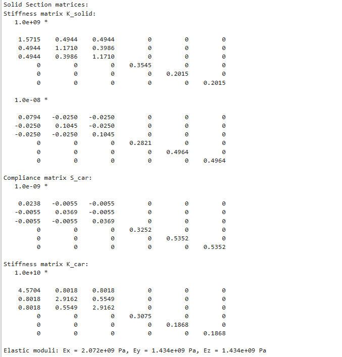

# Stiffness-Averaging-Matlab
MATLAB numerical solver implementing the stiffness averaging method to estimate effective elastic modulus
# Composite Elastic Modulus Estimator (Stiffness Averaging Method)

## Overview
Developed a **MATLAB** program implementing the **stiffness averaging method** to estimate the effective elastic modulus of multi-phase/composite materials. The script automates analytical stiffness matrix and micromechanical averaging calculations across constituent material properties and volume fractions.

## 📄 Technical Report
* **[View Full Project Report (PDF)](Stiffness-Averaging-Report.pdf)** — Includes theoretical derivations, micromechanical assumptions, code structure, and validation results.

## Key Features & Results
* **Automated Stiffness Calculation:** Computes effective elastic modulus ($E_{\text{eff}}$) from constituent phase properties (matrix and reinforcement moduli, volume fractions, and orientation/averaging bounds).
* **Parametric Evaluation:** Enables rapid testing across varying material compositions to analyze stiffness sensitivity and upper/lower mechanical bounds (e.g., Voigt/Reuss or orientation averaging).
* **Clean Numerical Workflow:** Structured with modular inputs and clear output plotting/tabulation for engineering verification.

## Visuals & Simulation Output

## How to Run
1. Clone or download this repository.
2. Open **Stiffness_averaging.m** in MATLAB.
3. Adjust the constituent material parameters (Young's moduli and volume fractions) in the input section if desired, and click **Run**.

## Tools & Methods
* **Programming:** MATLAB
* **Engineering Concepts:** Micromechanics of Composites, Stiffness Averaging Method, Analytical Material Property Estimation
